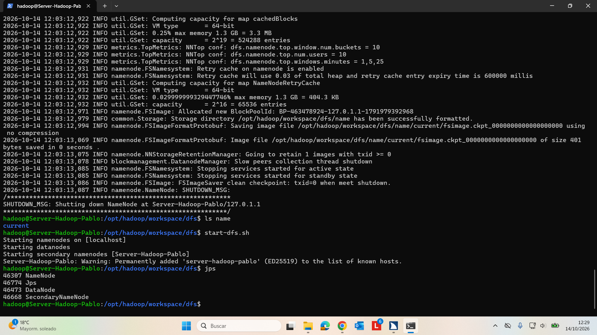

# PRÁCTICAS Big Data aplicado. PABLO MENDOZA MAYO

## **UNIDAD 2**

### instalación y configuración de Hadoop.

A continuación se muestra una captura que demuestra que  Hadoop se ha configurado correctamente.

