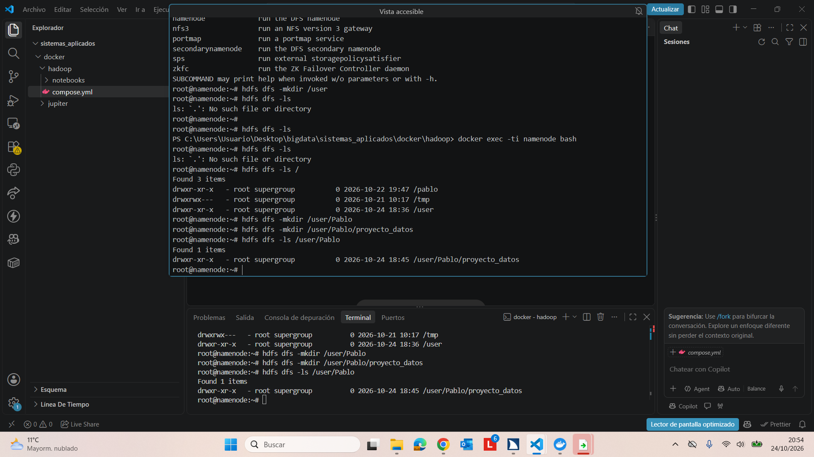

# PR0202: Uso del cliente HDFS

## Escenario:

Eres parte de un equipo de análisis de datos que trabaja con Hadoop. Cada usuario tiene su propio espacio en HDFS para almacenar y organizar datasets. Tu tarea es preparar tu espacio, cargar datos de prueba y practicar operaciones básicas de gestión en HDFS.

## Ejercicios
## Preparación del entorno

1. Crea un directorio personal en HDFS bajo /user con tu nombre de usuario y dentro de él un directorio llamado proyecto_datos.

Los comandos ejecutados en la captura de pantalla de arriba son:
Comando 1. Crear el directorio /user en HDFS: hdfs dfs -mkdir /user
Comando 2. Mostrar el contenido del directorio raíz de HDFS: hdfs dfs -ls /
Comando 3. Crear el directorio personal del usuario Pablo: hdfs dfs -mkdir /user/Pablo
Comando 4. Crear el directorio proyecto_datos dentro del directorio personal: hdfs dfs -mkdir /user/Pablo/proyecto_datos
Comando 5. Volver a consultar el contenido del directorio raíz: hdfs dfs -ls /

Comando 6. Comprobar el contenido del directorio personal: hdfs dfs -ls /user/Pablo

Carga de datasets

Descarga el dataset Automotive Price Prediction Dataset que puedes obtener desde Kaggle y que contiene un dataset sintético con información y precio de 1000000 de vehículos de segunda mano
Desde tu sistema local, sube al directorio proyecto_datos el dataset que has descargado.
Exploración de datos

Visualiza el contenido del archivo directamente en HDFS.
Obtén el número de líneas del dataset.
Organización del proyecto

Crea un subdirectorio procesados y otro backup dentro de tu carpeta de proyecto.
Copia el archivo original a backup.
Mueve el archivo original de proyecto_datos a procesados.
Colaboración en el equipo

Crea un directorio compartido bajo /compartido (si no existe) y copia allí tu dataset para que otros puedan acceder.
Recuperación de datos

Descarga a tu sistema local el archivo que está en el directorio procesados.
Control de accesos

Verifica los permisos de tus archivos.
Cambia los permisos de un archivo de backup para que solo tú tengas acceso de lectura y escritura.
Mantenimiento

Elimina un archivo temporal que hayas subido por error a tu espacio en HDFS.
(Opcional, avanzado)

Configura una cuota de número de archivos en tu directorio de proyecto y prueba a superar el límite para observar el comportamiento de HDFS.
Entrega
Sube a tu repositorio un documento que incluya:

Comando introducido en cada uno de los ejercicios
Una muestra de las primeras líneas de la salida
https://vgonzalez165.github.io/apuntes_bda/apuntes/ut02/04-cli-hdfs-administracion.html